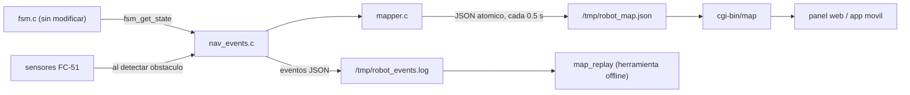

# Mapeo del recorrido

El robot construye un mapa incremental del área explorada a partir de la
odometría estimada de los motores y de los sensores de proximidad. El mapa es
una grilla 2D donde cada celda es desconocida, visitada u obstáculo, y se
publica en `/tmp/robot_map.json` para que el servidor lo muestre en el panel.

## Arquitectura



- `mapper.c` no toca hardware: recibe eventos con marca de tiempo y mantiene
  la pose estimada y la grilla. Por eso corre igual en el robot, en el
  simulador o reproduciendo un log.
- `nav_events.c` se engancha a la FSM sin modificarla: después de cada
  `fsm_update()` compara el estado con el anterior. Si cambió, escribe una
  línea en el log y avisa al mapper.
- `main.c` solo agrega 4 llamadas (ver `parche_main_c.patch`).

## Modelo de movimiento

Los motores no usan PWM (potencia completa), así que el movimiento se deduce
del estado de la FSM:

| Estado FSM | Movimiento supuesto |
|---|---|
| `MOVING_FORWARD` | avance a `speed_cm_s` |
| `BACKING_UP` | retroceso a `speed_cm_s` |
| `TURNING_LEFT` | giro antihorario sobre la rueda izquierda (quieta) |
| `TURNING_RIGHT` | giro horario sobre la rueda derecha (quieta) |
| cualquier otro | detenido |

Al girar sobre una rueda, el centro del chasis describe un arco de radio
`pivot_offset_cm` alrededor de la rueda quieta; el mapper lo integra así, no
como giro sobre el sitio.

Los sensores FC-51 son digitales y no miden distancia. Cuando la FSM pasa de
`MOVING_FORWARD` a `AVOID_STOP` se leen ambos sensores y se marca una celda de
obstáculo a `front_obstacle_cm` hacia adelante y/o `side_obstacle_cm` hacia la
izquierda del centro del robot. Las celdas bajo el robot (círculo de radio
`robot_radius_cm`) se marcan como visitadas; un obstáculo ya marcado no se
borra al pasar cerca.

El marco de referencia tiene el origen en el punto de arranque y el robot
mira inicialmente hacia arriba en el mapa.

## Log de eventos (`/tmp/robot_events.log`)

Una línea JSON por evento, tiempos en milisegundos desde que arrancó
`app_robot`. El log se reinicia en cada arranque y rota a `.1` al pasar 1 MB.

```json
{"t":0,"ev":"start","params":{"cell_cm":5.0,"speed_cm_s":20.0,...}}
{"t":10,"ev":"state","from":"IDLE","to":"MOVING_FORWARD"}
{"t":6000,"ev":"state","from":"MOVING_FORWARD","to":"AVOID_STOP"}
{"t":6000,"ev":"obstacle","front":1,"left":0,"x":0.0,"y":119.8,"th":90.0}
```

## Contrato del mapa

`/tmp/robot_map.json` lo escribe `app_robot` (archivo temporal + `rename`, el
CGI nunca lee un JSON a medias). `GET /cgi-bin/map` lo devuelve dentro del
formato estándar de la API:

```json
{"status":"ok","data":{
  "seq": 12, "cell_cm": 5.0, "width": 80, "height": 80,
  "origin": {"col": 40, "row": 39},
  "robot":  {"x": 81.8, "y": -87.8, "theta_deg": 313.2, "col": 56, "row": 56},
  "stats":  {"visited": 1300, "obstacles": 19, "out_of_bounds": 0},
  "grid": [[0,0,1,...], ...]
}}
```

- `grid[fila][columna]`: `0` desconocida, `1` visitada, `2` obstáculo. La fila 0
  es el norte del mapa.
- `theta_deg`: 0 = derecha, 90 = arriba, antihorario.
- `seq` aumenta con cada escritura; el cliente puede saltarse el redibujado si no cambió.
- Si `app_robot` no está corriendo, `/cgi-bin/map` responde `503`.
  Esto reemplaza la grilla vacía de ejemplo que devolvía la versión anterior.

Esto actualiza la fila de `/tmp/robot_map.json` de la tabla de archivos
compartidos en `cgi/README.md`: el formato ya no es solo `{"width","height","grid"}`.

Para dibujarlo, `www/js/map_view.js` expone `drawMap(canvas, data)`.

## Parámetros y calibración

Se leen de `/etc/robot_map.conf` (se instala desde la receta). **Todos los
valores por defecto son provisionales.**

| Parámetro | Qué es | Cómo medirlo |
|---|---|---|
| `speed_cm_s` | velocidad de avance | marcar el piso, ejecutar `FORWARD` 3 s, medir distancia / 3 |
| `turn_rate_deg_s` | velocidad angular al girar | ejecutar `TURN_RIGHT` 3 s, medir el ángulo total (contar vueltas) / 3 |
| `pivot_offset_cm` | centro del chasis a la rueda quieta | regla: la mitad de la separación entre ruedas |
| `robot_radius_cm` | radio del robot | regla |
| `front_obstacle_cm`, `side_obstacle_cm` | distancia centro-obstáculo al encenderse el LED del FC-51 | acercar una pared despacio hasta que el LED se encienda y medir desde el centro del robot |
| `turn_sign` | `1` si `TURN_RIGHT` gira en sentido horario visto desde arriba, `-1` si sale invertido | observar un giro |
| `cell_cm`, `grid_w`, `grid_h` | resolución y tamaño de la grilla | 80 x 80 de 5 cm cubre 4 m x 4 m |

El supuesto del giro es que el motor A (`IN1/IN2`) mueve la rueda izquierda.
Si en el robot real `TURN_RIGHT` gira hacia la izquierda, poner `turn_sign=-1`.
El alcance de los FC-51 depende del potenciómetro y del color de la superficie:
fíjenlo antes de medir y no lo toquen.

Para ajustar sin volver a correr el robot, copien `/tmp/robot_events.log` y
repitan la reconstrucción con otros valores:

```bash
tools/map_sim/map_replay events.log -c robot_map.conf -o mapa.json --ascii
```

## Integración

1. Aplicar el parche a `main.c` (desde la raíz del repo):
   `patch -p1 < parche_main_c.patch`
2. Copiar los archivos nuevos de `navegacion/files/` y la receta
   `navegacion_1.0.bb` actualizada (agrega las fuentes a `SRC_URI`, instala
   `robot_map.conf` y enlaza con `-lm`).
3. Revisar `cgi/map.c` contra la versión actual del repo antes de reemplazarla.
4. En `index.html` agregar un `<canvas id="map-canvas" width="600" height="600">`
   y cargar `js/map_view.js`; en el polling de `app.js` llamar a `drawMap`.

## Simulador y replay

`tools/map_sim/` ejecuta el `fsm.c` real (sin modificar) y los mismos
`mapper.c` y `nav_events.c` del robot. Solo reemplaza el hardware: un robot
virtual en una sala de 3 m x 2.4 m con dos cajas, sensores digitales simulados
y reloj virtual. Se compila en el host con `gcc`, sin Yocto.

```bash
cd tools/map_sim
make
make run          # parámetros iguales al modelo
make run-drift    # robot "real" distinto del modelo
./map_sim --secs 300 --seed 4 --out mapa.json --log eventos.log
```

### Resultados (120 s virtuales, semilla 1)

| | Parámetros iguales | Parámetros desajustados* |
|---|---|---|
| Celdas visitadas que coinciden con lo recorrido | 99.5 % | 38.7 % |
| Obstáculos cerca de una pared o caja real | 100 % | 20.0 % |
| Error de pose final | 0.2 cm, 0.0° | 327 cm, 178° |

\* velocidad real 12 % mayor, giro 15 % menor y sensor frontal 10 % más corto
que lo que supone el modelo.

Con parámetros exactos, 8 semillas de 5 minutos dan un error de rumbo de 0° y
un error de posición entre 0.2 y 117 cm. El error de posición crece con el
tiempo que el robot simulado pasa empujado por una pared sin sensor
(0 s de contacto: 0.2 cm; 27 s: 117 cm).

## Limitaciones conocidas

- **Calibración.** Sin calibrar, el mapa no sirve: el desajuste de la tabla
  anterior lo descompone en menos de un minuto. Es la tarea pendiente más
  importante y requiere el robot físico.
- **Deriva.** Sin encoders ni IMU, la pose se estima solo con tiempo y
  velocidad. Cualquier contacto con una pared, deslizamiento de ruedas o
  caída de la batería acumula error que nada corrige. En el simulador el
  contacto se modela como un simple tope; en el robot real también afecta al
  rumbo, así que el error real puede ser peor.
- **Sensores digitales.** Cada detección marca una sola celda a distancia
  fija; las paredes salen punteadas (19 celdas en 2 minutos simulados).
- **Modo manual no se mapea.** Los comandos manuales los ejecuta el proceso
  del CGI, no `app_robot`. Al volver a autónomo la pose puede estar
  desfasada. Para cubrirlo habría que emitir el evento desde `robot_move()`
  de `librobot`, por donde pasan ambos procesos.
- **Reinicio.** Cada vez que arranca `app_robot` el mapa y la pose vuelven al origen.
- **Sensor lateral.** Solo existe el izquierdo, así que no se mapean obstáculos a la derecha.
- **Sin verificar en el robot.** Se probó en el simulador del host. No se ha
  compilado con `bitbake` ni ejecutado en QEMU o en la Raspberry Pi.
